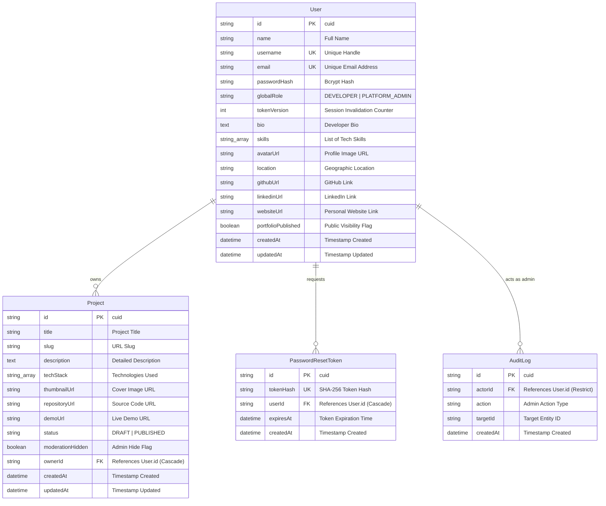

# Entity Relationship Diagram Devfy

Berikut adalah struktur hubungan antar entitas pada database PostgreSQL yang diatur melalui Prisma ORM.

## Karakteristik dan Indeks Database

1. **Integritas Relasi**:
   - `User` ke `Project`: Relasi 1 ke N dengan `onDelete: Cascade`. Menghapus akun otomatis menghapus seluruh proyek miliknya.
   - `User` ke `PasswordResetToken`: Relasi 1 ke N dengan `onDelete: Cascade`. Menghapus akun otomatis membersihkan token pemulihan terkait.
   - `User` ke `AuditLog`: Relasi 1 ke N dengan `onDelete: Restrict`. Log audit admin dipertahankan dan akun admin tidak bisa dihapus jika meninggalkan riwayat audit.

2. **Indeks Performa (Indexes)**:
   - `Project`:
     - Unique Composite Index: `[ownerId, slug]` (Mencegah duplikasi slug proyek dalam akun yang sama).
     - Composite Index: `[ownerId, status]` (Mempercepat query filter proyek aktif di dashboard).
   - `PasswordResetToken`:
     - Index: `[userId]` (Pencarian token milik pengguna tertentu).
     - Index: `[expiresAt]` (Pembersihan token kadaluwarsa secara berkala).
   - `AuditLog`:
     - Composite Index: `[actorId, createdAt]` (Audit trail per administrator).
     - Composite Index: `[targetId, createdAt]` (Audit trail per target proyek/pengguna).
