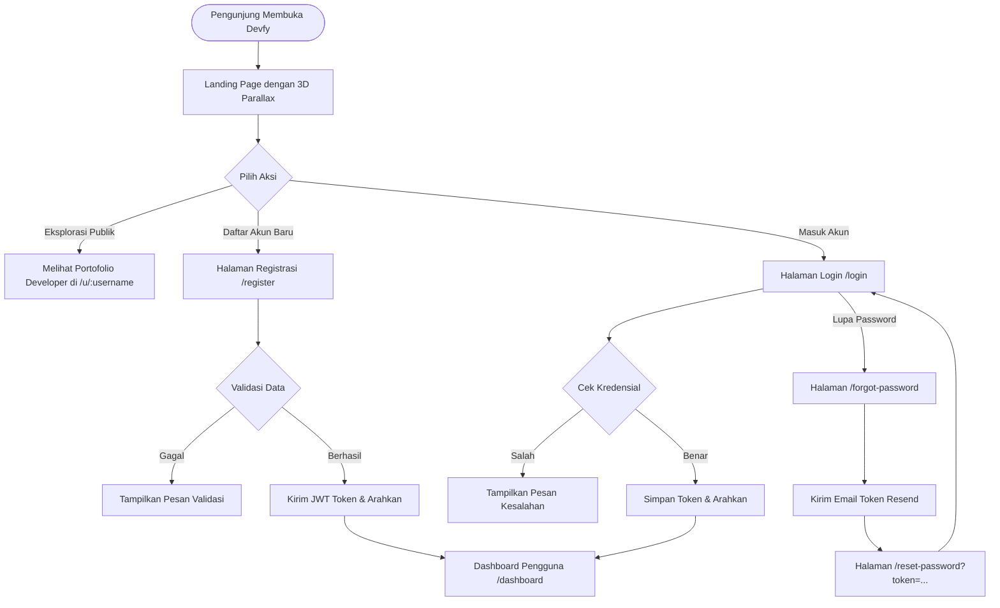
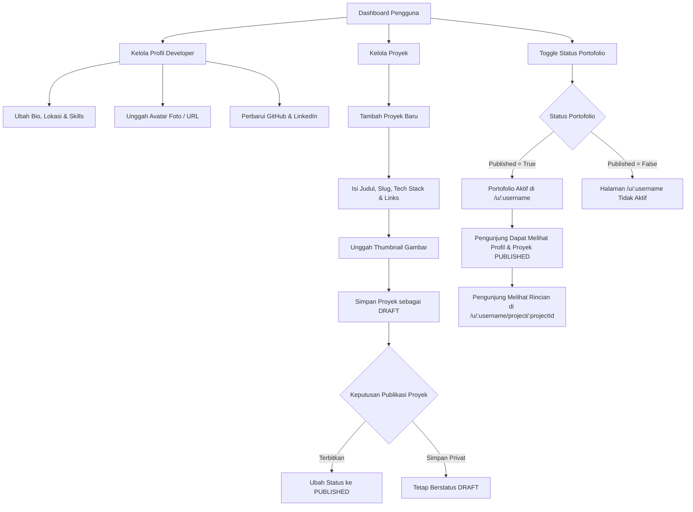

# Alur Pengguna (User Flows) Devfy

Diagram berikut memetakan perjalanan pengguna (user journey) dari pengunjung awal hingga menjadi developer yang mempublikasikan portofolionya.

## 1. Alur Pengunjung dan Autentikasi

## 2. Alur Pengelolaan Portofolio dan Publikasi

